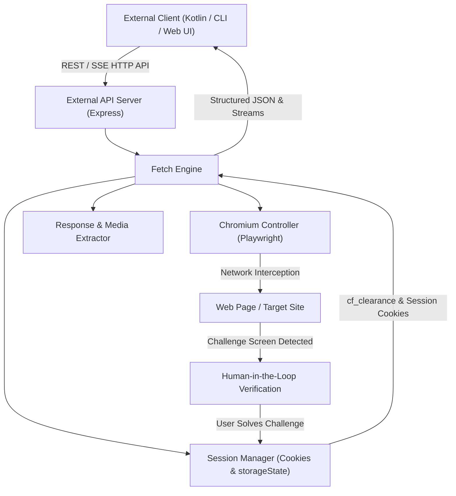

# Chromium-Based External Fetch & Web Compatibility System

A modular, educational Chromium-based external fetching system inspired by modern browser extensions and browser automation architectures.

---

## 🏛️ System Architecture



### Core Components:

1. **Chromium Controller (`src/browser/controller.js`)**:
   * Controls Chromium lifecycle, persistent context/profiles, and headed/headless switching.
   * Masks automated `navigator.webdriver` flags to maintain compatibility with modern web standards.

2. **Fetch Engine (`src/engine/fetcher.js`)**:
   * Intercepts all network traffic (`request` and `response` events).
   * Identifies streaming protocols (HLS `.m3u8`, `/hls/`, MPEG-DASH `.mpd`, `.mp4`).
   * Detects verification challenges (HTTP 403/503, "Just a moment...", Turnstile containers).
   * Supports auto-interaction (clicking play buttons inside iframes to trigger streaming calls).

3. **Session Manager (`src/session/manager.js`)**:
   * Persists cookies and local storage to disk (`sessions/default_session.json`).
   * Preserves authorized session state between requests without re-verifying.

4. **Response & Media Parser (`src/parser/extractor.js`)**:
   * Classifies network resources (`media`, `xhr`, `document`, `asset`).
   * Extracts metadata (HTTP status, title, headers, JSON data, raw HTML preview).

5. **External REST & SSE API (`src/server/api.js`)**:
   * Exposes language-agnostic HTTP endpoints (`/api/fetch`, `/api/status`, `/api/history`, `/api/session/clear`).
   * Streams real-time network logs and challenge alerts via Server-Sent Events (`/api/events`).

6. **Web Management Dashboard (`public/`)**:
   * Dark-themed visual interface to monitor browser status, inspect intercepted traffic, view response previews, and spotlight captured HLS media streams.

7. **External Kotlin Client (`src/client/KotlinClientExample.kt`)**:
   * Educational reference implementation demonstrating how an external Kotlin application (Desktop, Android, or Server) connects to the Chromium engine.

---

## 🛡️ Cloudflare & Web Verification: Technical Analysis

### How Verification Works Under the Hood:
Modern protection layers (like Cloudflare Turnstile, DDoS mitigation, and bot detection) inspect multiple signals:
* **TLS Fingerprint:** Cipher suites, extensions, and elliptic curves (JA3 / JA4 signatures).
* **Browser Environment:** Inspects `navigator.webdriver`, canvas rendering, WebGL context, audio latency, and device memory.
* **Behavioral Telemetry:** Natural mouse trajectories, focus transitions, and keypress intervals.
* **Proof-of-Work (PoW):** Background computational cryptographic tasks executed inside sandboxed JavaScript challenges.

### The "Human-in-the-Loop" Pattern:
Automated attempts to spoof or defeat these protections are fragile, constantly break, and violate platform policies. The industry-standard architecture for authorized access is **Human-in-the-Loop (HITL)**:
1. **Challenge Detection:** The engine detects that a challenge page has been served (via page title, status code, or DOM markers).
2. **Alert External System:** The engine transitions its status to `CHALLENGE_REQUIRED` and notifies external clients via SSE.
3. **User Verification in Visible Browser:** The Chromium window is visible to the authorized human user. The user completes the interactive verification naturally.
4. **Session Persistence:** Once verified, the engine detects that the challenge passed, extracts the clearance cookies (e.g., `cf_clearance`), and saves them to `sessions/default_session.json`.
5. **Subsequent Autonomous Requests:** Future requests reuse the saved session state without requiring re-verification until the token expires.

---

## 🚀 Quick Start Guide

### 1. Install & Run
```bash
cd chromium-fetch-system
npm install
npm start
```
The server will start at **`http://localhost:3000`**.

### 2. Access the Management Dashboard
Open your browser and navigate to:
```
http://localhost:3000
```
* Enter any URL you wish to fetch.
* Enable **"Headed Browser"** to keep the browser window visible.
* Enable **"Auto-Trigger Playback"** if fetching a video page to simulate user interaction and intercept background HLS streams.
* Click **Fetch Target**.

### 3. API Reference

#### Fetch Target URL
```http
POST /api/fetch
Content-Type: application/json

{
  "url": "https://example.com",
  "headed": true,
  "autoInteractMedia": true,
  "timeout": 35000
}
```

#### Browser Status
```http
GET /api/status
```

#### Real-Time SSE Stream
```http
GET /api/events
```

#### Reset Session
```http
POST /api/session/clear
```
